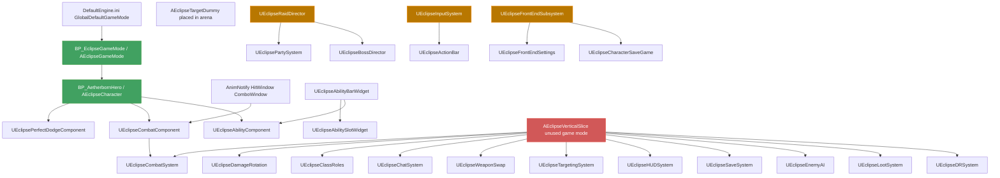

# ECLIPSE — System Dependencies

*Generated 2026-11-08 (plan `slate_heron_ledger_v1`) from a static scan of `Source/EclipseRotF/`: a class counts as referenced when its name appears in another file. Read-only.*

## 1. Runtime map

Green = live path. Red = unused integrator. Gold = unused cluster root.

## 2. Reference table

| Class | Base | Inbound refs (files) | On live path? |
|---|---|---|---|
| `AEclipseGameMode` | AGameModeBase | 0 (used via `BP_EclipseGameMode`) | **Yes** |
| `AEclipseCharacter` | ACharacter | 9 | **Yes** |
| `UEclipseCombatComponent` | UActorComponent | 7 | **Yes** |
| `UEclipseAbilityComponent` | UActorComponent | 5 | **Yes** |
| `UEclipsePerfectDodgeComponent` | UActorComponent | 3 | **Yes** |
| `UEclipseCombatSystem` | UObject | 4 | Yes (via combat component) |
| `UEclipseAnimNotify_HitWindow/_ComboWindow` | UAnimNotify | 0 (used on montages) | **Yes** |
| `AEclipseTargetDummy` | AActor | 0 (placed in map) | **Yes** |
| `UEclipseAbilityBarWidget` / `UEclipseAbilitySlotWidget` | UUserWidget | 0 / 2 | Unknown — no WBP parent verified |
| `AEclipseVerticalSlice` | AGameModeBase | 0 | No |
| DR, Loot, EnemyAI, Save, HUDSystem, Targeting, WeaponSwap, Chat, ClassRoles, DamageRotation | UObject | 2 each (VerticalSlice only) | No |
| `UEclipseRaidDirector` | UObject | 0 | No |
| `UEclipseBossDirector`, `UEclipsePartySystem` | UObject | 2 (RaidDirector only) | No |
| `UEclipseInputSystem` | UObject | 0 | No |
| `UEclipseActionBar` | UObject | 2 (InputSystem only) | No |
| `UEclipseQuestSystem`, `UEclipseTalentSystem`, `UEclipseSpellSystem`, `UEclipseClassAbilities`, `UEclipseCompanionAI`, `UEclipseGameFeel`, `UEclipseVisualPipeline` | UObject | 0 | No |
| `AEclipseSolaraLevel` | AActor | 0 | Unknown (may be placed in `Lvl_SolaraCathedral`) |
| `UEclipseKeybindSubsystem` | UGameInstanceSubsystem | 0 | Auto-created by engine; consumer `WBP_KeyBindings` is broken |
| `UEclipseFrontEndSubsystem` | UGameInstanceSubsystem | 0 | Auto-created; no widget consumes it |
| Slice classes (`AAetherbornCombo*`, `AAetherbornComboTiming*`) | various | 0 from production | Own maps only |

## 3. Cross-cutting dependencies

| Dependency | Consumers | Risk |
|---|---|---|
| Enums in `EclipseCharacter.h` (`EAncestry` 13, `EClass` 17, `EElementalAffinity` 11, `EResourceType`, `ERarityTier`) | almost every system | Changing affinity count (C8) touches Talent, Spell, ClassAbilities |
| `FGameFeelProfile` / `ECombatState` | Combat, PerfectDodge, AnimNotifies | Canon §2 constants live here |
| `SetGlobalTimeDilation` | Perfect dodge slow-mo, hit-stop | Must not run both at once (canon §2) |
| Enhanced Input `IMC_Default` | Character | `UEclipseInputSystem` duplicates it (C5) |
| `SK_Mannequin` skeleton | All production montages | `AetherbornHero` uses its own skeleton → retarget needed to swap the pawn body |
| Replication | none | Every system is single-player only today |
