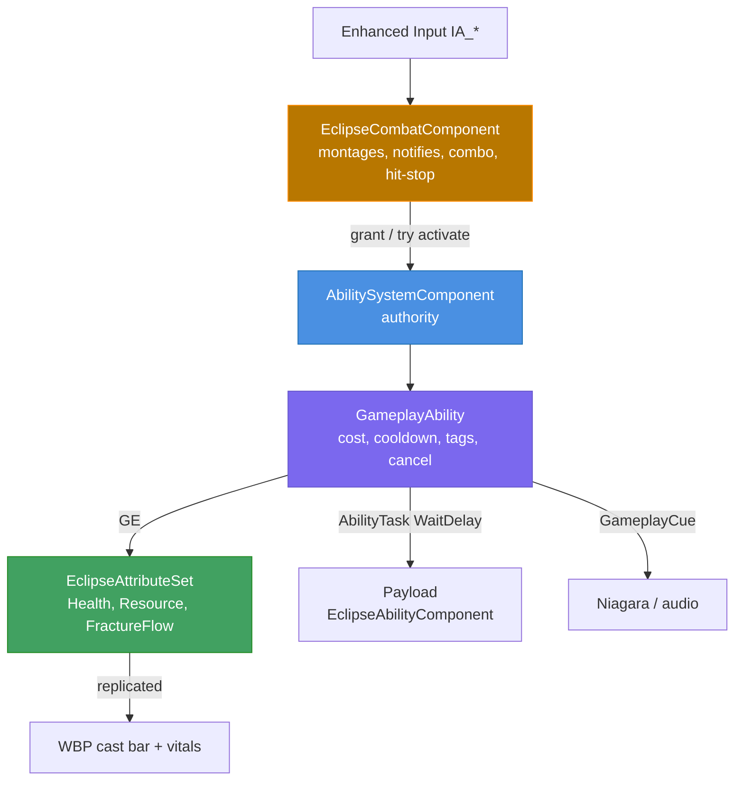
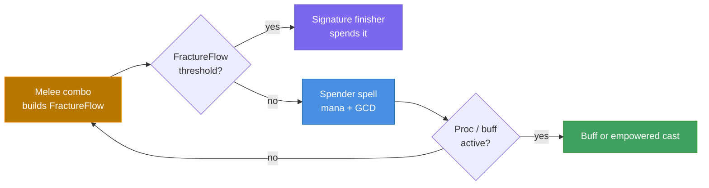

# ECLIPSE: REALMS OF THE FRACTURED
## Unified Combat Production Directive — v1.3

**Merges:** *AAA Combat Animation Production System* + *AURA MASTER DIRECTIVE V1: PLAYABLE FOUNDATION*
**Adds:** the GAS architecture ruling · the two-layer combat contract (Elden Ring / Black Myth feel + WoW rotation) · the verified rendering baseline
**Project:** `EclipseRotF` · `C:\Users\Tap\EclipseRotF` · UE **5.8.4**

---

## 0. Verified baseline — do not re-investigate

Read directly from disk. Ground truth for every phase below.

| Fact | Value | Evidence |
| --- | --- | --- |
| Engine | UE 5.8.4, root `C:\Program Files\Epic Games\UE_5.8` | `get_editor_status` |
| Engine association | GUID `{869CFE0D-4AA7-102E-0A60-62AF49232C9E}` | `.uproject` |
| Modules | one runtime module, `EclipseRotF` | `.uproject` |
| **Live Coding** | **DISABLED** | `trigger_live_coding` refused → every C++ change is a full rebuild + restart |
| Module deps (public) | `Core, CoreUObject, Engine, InputCore, EnhancedInput, Niagara, NiagaraCore, GameplayTags, GameplayTasks` | `EclipseRotF.Build.cs` lines 9–13 |
| Module deps (private) | `Slate, SlateCore, UMG, AIModule` | `EclipseRotF.Build.cs` lines 15–17 |
| **`GameplayAbilities` module** | absent from `EclipseRotF.Build.cs` — **but the plugin is already enabled and loaded** | `unreal.load_class(None, "/Script/GameplayAbilities.AbilitySystemComponent")` → **LOADED** |
| GAS symbols in `Source/` | **zero** | grep `GameplayAbilities\|AbilitySystemComponent\|GameplayEffect` → no files |
| Enabled plugins | Aura, Niagara, EnhancedInput, ModelContextProtocol, PythonScriptPlugin, AccumulationDOF, BinkMedia, TextureShare, StaticMeshEditorModeling, ShaderToolkit | `.uproject` lines 13–58 |
| Plugin state | see the verified plugin table below — **not** inferable from `.uproject` absence | runtime module probes + engine `.uplugin` descriptors |

`GameplayTags` and `GameplayTasks` are already dependencies with **no consumer anywhere in `Source/`** — the project was half-wired for GAS and never finished.

### Plugin states — verified, not inferred

**A plugin missing from `.uproject` is not a disabled plugin.** `.uproject` records only *overrides*; an omission means the plugin keeps its `EnabledByDefault` state, which for most engine plugins is **on**. The only trustworthy tests are a runtime module probe and the engine `.uplugin` descriptor.

| Plugin | State | Evidence |
| --- | --- | --- |
| `GameplayAbilities` | **already ON** | `AbilitySystemComponent` class resolves at runtime |
| `ControlRig` | **already ON** | `ControlRig` class resolves at runtime |
| `IKRig` | **already ON** | `IKRigDefinition` class resolves at runtime |
| `GeometryScripting` ("Geometry Script") | **already ON** | descriptor sets no `EnabledByDefault` key → enabled |
| `MetaHumanSDK` | **already ON** | `"EnabledByDefault": true` |
| `PoseSearch` (motion matching) | **OFF** | `"EnabledByDefault": false`; class does not resolve |
| `MotionWarping` | **OFF** | `"EnabledByDefault": false` |
| `AnimationWarping` | **OFF** | `"EnabledByDefault": false` |
| `AnimationLocomotionLibrary` | **OFF** | `"EnabledByDefault": false` |
| `BlendStack` | **OFF** | `"EnabledByDefault": false` |
| `Chooser` | **OFF** | `"EnabledByDefault": false` |
| `ChaosClothAsset` | **OFF** | `"EnabledByDefault": false` |
| `DeformerGraph` | **OFF** | `"EnabledByDefault": false` |
| `MetaHumanCharacter` | **OFF** | `"EnabledByDefault": false` |
| `MetaHumanCrowd`, `MetaHumanCoreTech`, `MetaHumanCoreML`, `MetaHumanAnimationTools` | **OFF** | `"EnabledByDefault": false` |

**Consequence for the plan:** GAS needs **no plugin change at all** — one Build.cs line. The seven animation plugins (`PoseSearch`, `MotionWarping`, `AnimationWarping`, `AnimationLocomotionLibrary`, `BlendStack`, `Chooser`, `DeformerGraph`) are exactly the set Epic's Game Animation Sample depends on, so they are a Phase 2 prerequisite, not a Phase 0 one.

### Existing systems that already work — DO NOT REWRITE

| Class | Responsibility today |
| --- | --- |
| `AEclipseCharacter` | capsule, `Mesh`, `CameraBoom` (arm 340, socket offset `(0,40,70)`), `TPPCamera` FOV 90, `HeroMesh` static placeholder, **`WeaponMesh` on bone `hand_r`**, `CharacterMovement` |
| `UEclipseCombatComponent` | montage playback, hit-window notifies, `PerformSweep` (ECC_Pawn, 300 cm, r 110), combo indexing, `ECombatState`, `EAttackPhase`, hit-stop, parry window, block threshold, stagger gating |
| `UEclipseAbilityComponent` | `ActivateAbility(FName)` payload dispatch |
| `UEclipseCombatSystem` | combat orchestration helpers |
| `UEclipsePerfectDodgeComponent` | perfect-dodge detection + reward window |
| `EclipseAnimNotifies` | `UEclipseAnimNotify_HitWindow` → `OpenHitWindow()`; `UEclipseAnimNotify_ComboWindow` → `OpenComboWindow()` |

Combat defaults in force: `LightDamage 40`, `HeavyDamage 90`, `AttackRange 300`, `AttackRadius 110`, `MaxComboSteps 5`, `BlockHoldThreshold 0.25`, `StaggerDamageThreshold 55`, `StaggerFallbackSeconds 0.35`, `ParryWindowSeconds 0.08`, `HeavyRecoverySeconds 0.60`, `DamageBuffMultiplier 1.0`. Character: `WalkSpeed 500`, `SprintSpeed 950`, `MaxHealth 1000`, `MaxResource 100`, `MaxFractureFlow 100`, `GlobalCooldownDuration 1.0`, `AetherBoltCastSeconds 0.9`.

### Assets that already exist

`BP_AetherbornHero`, `BP_EclipseGameMode`, `SKM_Manny_Simple` + `ABP_Unarmed`, `IMC_Default` + `IA_*` (LightAttack, HeavyAttack, Dodge, Block, Ability1–4), `Lvl_Stage1_Arena`, `Lvl_SolaraCathedral`, `WBP_KeyBindings`, `WBP_AetherbornComboHUD`.

Montages in `/Game/Animations/Combat/`: `AM_Light_01/02/03`, `AM_Heavy`, `AM_Dodge`, `AM_HitReact_Lgt/Med/Hvy`, `AM_Cast_01` (0.700 / 0.767 / 0.800 / 1.833 s, no notifies authored).

### Honest gap register — what does NOT exist

| Gap | Blocks | Unblock path |
| --- | --- | --- |
| **No weapon mesh** anywhere in `/Game` | armed silhouette | generate a sword static mesh → `SetWeaponMesh()` |
| **No block or parry clip** in the 102-asset mannequin animation set | defensive visuals (`BlockMontage`/`ParryMontage` are `None`) | generate two one-off biped clips onto `SKM_Manny_Simple` |
| **Game Animation Sample 5.8 not imported** | motion-matched locomotion | Launcher / Fab → Migrate (not fetchable programmatically) |
| **No cast bar widget** reading `CastProgress` | readable cast feedback | Phase 3 |
| **No Sentinel AI** — only `AEclipseTargetDummy` C++ | a real enemy to validate against | StateTree + AIPerception, Phase 4 |
| **`L_Eclipse_CombatVerticalSlice` does not exist** | the named slice level | Phase 5 |
| **No PIE verification of the armed loop** | any claim of "working" | Phase 6 is mandatory |

---

## 1. The ruling: GAS owns the math, the components own the feel

One architecture. Not a rewrite, not a parallel system.

| Concern | Owner | Reason |
| --- | --- | --- |
| Health, Resource/Mana, FractureFlow and their maxima | **GAS AttributeSet** | replicated, clamped, GE-modifiable |
| Damage, healing, buffs, debuffs | **GameplayEffect** | one authoritative path; no direct field writes |
| Cooldowns, global cooldown, cast/channel lockouts | **GameplayEffect granting tags** | tag lookup is cheap and replicates |
| Ability activation, cancellation, interruption | **GameplayAbility** | cancel-by-tag *is* the cast-interrupt requirement |
| Montage selection, notify dispatch, combo branching, hit-stop, camera | **`UEclipseCombatComponent`** (unchanged) | feel is frame-authored, not attribute math |
| Sweep detection, hit target resolution | **`UEclipseCombatComponent`** (unchanged) | already works |
| VFX / audio per ability event | **GameplayCue** | fires on every client, no replication code |

**Hard constraint carried forward:** gameplay timing is server-authoritative and is *never* derived from a cosmetic animation event. The cast bar completes on `CastDuration`; the payload fires only through `OnCastFinished(true)`. GAS inherits this rule — a cast-ending `GameplayAbility` uses `AbilityTask_WaitDelay`, never montage length.

**Migration rule:** every existing public field survives. `LightDamage 40`, `HeavyDamage 90`, `StaggerDamageThreshold 55`, `GlobalCooldownDuration 1.0`, `AetherBoltCastSeconds 0.9` become the *sources* that populate GE magnitudes and ability timings. Nothing is deleted until its GAS replacement is proven in PIE.

---

## 1b. Combat identity — the two-layer contract

The three references do not blend by averaging them. They blend by **separating two input layers that share one damage pipeline.** Averaging them produces the classic failed action-MMO: melee that commits like Elden Ring *and* is GCD-locked like WoW, which feels catatonic.

### The conflict, stated plainly

| Axis | Elden Ring / Black Myth | World of Warcraft |
| --- | --- | --- |
| What gates the next action | animation commitment + stamina | global cooldown (1.0 s here) |
| When damage lands | weapon sweep connects | ability activation |
| Facing / target | free-aim, soft lock, spacing matters | hard/soft target, auto-facing |
| Skill expression | timing, i-frames, position | priority-list order, proc awareness |
| Feedback | hit-stop, camera shake, impact frames | numbers, damage meters, no hit-stop |
| Ability count in play | 2–4 | 8–15 |

### The resolution

| Layer | Inputs | Gated by | Damage resolves | Reference |
| --- | --- | --- | --- | --- |
| **Action layer** | LMB / RMB, dodge, block, parry | animation commit + **stamina** | on weapon sweep (anim notify) | Elden Ring / Black Myth |
| **Rotation layer** | action bar 1–8 | **GCD** + mana + cooldown tags | on ability activation / projectile hit | WoW |

**Rules that make it work — these are not negotiable:**

1. **The GCD gates the rotation layer only.** It must never gate the action layer. Melee is gated by animation commitment and stamina. Applying `GlobalCooldownDuration 1.0` on top of the 1,750 ms three-hit chain is what kills the Elden Ring feel.
2. **Damage resolves where its reference resolves it.** Action layer = on sweep via `UEclipseAnimNotify_HitWindow` → `PerformSweep`. Rotation layer = on activation. Do not unify these: if a swing applies damage on input press, whiffs still damage and spacing stops mattering.
3. **Melee builds FractureFlow; abilities spend it.** This is the weld between the two halves — the action layer feeds the rotation (WoW's builder/spender model applied to action melee), so the combo is not cosmetic. A player who only presses 1–8 runs dry; a player who only swings never lands a signature.
4. **Three currencies, already present as fields.** Stamina (dodge / sprint / block-hold / parry) — the Elden Ring currency, already `SprintStaminaPerSecond 15`. Mana (`MaxResource 100`) — the spell currency. FractureFlow (`MaxFractureFlow 100`) — the signature/finisher currency.
5. **Two different cancel rules.** The action layer cancels *into* dodge on a recovery window (Elden Ring). The rotation layer is cancelled only by an interrupt tag (`State.Casting` → `GA_Dodge`) — you cannot dodge-cancel a spell into safety for free.
6. **Hit-stop exists in the action layer only.** WoW has none. `UEclipseCombatComponent`'s hit-stop is the single biggest source of Elden Ring impact and must never be applied to rotation-layer abilities.
7. **Soft-lock, not tab-target.** Free-aim by default, with an auto-face assist inside a forward cone for rotation-layer abilities. Melee sweeps; spells assist. This is what every shipped action MMO does and it keeps both halves playable.

### Why the rotation is a priority list, not a sequence

WoW rotations are priority lists over GCD-sized slots with procs. Eclipse expresses the same thing with far fewer buttons because the action layer occupies most of the player's attention:

Six to eight abilities is the correct ceiling for this hybrid. Fifteen is a WoW number that assumes the player is not also reading telegraphs.

---

## 1c. Graphics target — the renderer is already there, the content is not

Verified from `Config/DefaultEngine.ini`: the project is **already configured to the Elden Ring / Black Myth rendering target.** Nothing needs to be enabled on the renderer.

| Setting | Value | Effect |
| --- | --- | --- |
| `r.Lumen.GlobalIllumination` / `.Reflections` | True | full Lumen GI + reflections |
| `r.Lumen.ScreenSpaceGI` / `ScreenSpaceReflection` | True | Lumen screen-space fallback |
| `r.LumenRayLighting` / `r.Lumen.DirectLighting` | True / 1 | ray-traced Lumen lighting |
| `r.Nanite.Enabled` / `.Programmable` | True | Nanite geometry on static meshes |
| `r.Shadow.Virtual.Enable` | 1 | virtual shadow maps, 4096 max resolution |
| `AntiAliasingMethod` + `TemporalAA.Upsampling` | 3 / True | **TSR** — the correct AA for Lumen |
| `r.VolumetricFog` / `r.VolumetricCloud` | True | atmospheric depth |
| `r.MotionBlurQuality` / `DepthOfFieldQuality` / `BloomQuality` | 4 / 4 / 5 | cinematic post chain |
| `r.SkinCache.CompileShaders` | True | skeletal mesh GPU skinning (required for high bone counts) |
| `r.VirtualTextures` | True | large-world texture streaming |

**So the graphics gap is content, not configuration.** What exists today is a static placeholder: `HeroMesh` holds `AETHERBORN_HERO_AAA` fitted to the capsule, and the real body is `SKM_Manny_Simple`. `Lvl_Stage1_Arena` is a blockout. Lumen lighting a placeholder still looks like a placeholder.

What actually has to be produced, in order of visual return:

| Requirement | Status | Notes |
| --- | --- | --- |
| Skeletal hero with real topology | missing | `MetaHumanCharacter` is default-disabled (`MetaHumanSDK` is already on); Blender/ZBrush sculpt is the final path |
| Groom hair | missing | no Groom asset authored |
| Chaos Cloth for armor shards | missing | `ChaosClothAsset` is default-disabled — required for the Modular Celestial Armor to read as cloth |
| Control Rig IK | missing | **plugins already enabled** — no rig assets authored yet; foot plant and weapon grip depend on it |
| Nanite arena assets | missing | arena is blockout geometry |
| Niagara wings / fracture trails | missing | plugin enabled, no assets |
| Weapon mesh | missing | see Phase 2 |

**Fidelity budget — the honest constraint.** Elden Ring renders one player and a handful of AI. Black Myth renders one player. An MMO renders 20–40 characters. Spend the budget deliberately:

- **Full fidelity:** the player, the boss, the weapon, the arena's hero lighting, the fracture/wing Niagara.
- **Reduced:** crowd characters — no Groom, no cloth simulation beyond the nearest N characters, HLOD for distant geometry, aggressive LOD bias.
- Never allow per-character cloth + hair simulation on every player in a populated area; that is the specific thing that breaks this genre.

---

## 2. Non-negotiable rules (merged from both directives)

- Inspect before generating — never author against an assumed project state
- Preserve canon: 13 ancestries, 14 bosses, faction and naming canon intact
- Preserve every working system; never overwrite a working feature without demonstrating why
- **Do not overwrite existing game assets without comparison and backup**
- Small, testable stages — one provable increment at a time
- Produce real assets, not stubs
- Validate in PIE before claiming anything works
- Never claim untested success
- Report gaps accurately — a blocked item is reported as blocked
- Stay inside the declared phase; do not expand to other ancestries

---

## 3. Phase 0 — Module and plugin foundation

The one expensive step (full rebuild; Live Coding off) — so **every module-level change lands in this single build.**

1. Add `GameplayAbilities` to `PublicDependencyModuleNames` in `Source/EclipseRotF/EclipseRotF.Build.cs` — **this is the only module change GAS needs**; the plugin is already enabled, so `.uproject` is not touched in this phase
2. `rebuild_and_restart_editor` **once** — this build also carries every Phase 1 C++ header
3. Verify `unreal.load_class(None, "/Script/GameplayAbilities.AbilitySystemComponent")` still resolves
4. Verify `[WEAPON]` / `[ANIM]` log lines still appear — proof nothing regressed
5. Land `UEclipseAttributeSet` and `UEclipseAbilitySystemComponent` in this same build rather than discovering them at Phase 1

**Gate:** module compiles, editor returns to the same level, no new log errors.

---

## 4. Phase 1 — GAS core (same build as Phase 0)

### 1a. `UEclipseAttributeSet` (UAttributeSet subclass)

- `Health` / `MaxHealth` (1000)
- `Resource` / `MaxResource` (100)
- `FractureFlow` / `MaxFractureFlow` (100)
- `AttackPower` / `DamageMultiplier` (seeded from `DamageBuffMultiplier 1.0`)
- `PreAttributeChange` clamps to `[0, Max]`; `PostGameplayEffectExecute` routes death/stagger into the existing path

### 1b. ASC hookup on `AEclipseCharacter`

- `UEclipseAbilitySystemComponent` thin subclass (future tag/cue overrides get a home)
- `UAttributeSet` instanced in `BeginPlay`
- `IAbilitySystemInterface::GetAbilitySystemComponent()` implemented
- **Owner + Avatar actor info set** — an ASC without an avatar actor silently refuses gameplay cues and has no net relevance
- `InitAbilityActorInfo` on server and client, re-called on `OnRep_PlayerState`

### 1c. GameplayEffects

| Effect | Policy | Detail |
| --- | --- | --- |
| `GE_Damage_Light` | Instant | `Health` negative, set-by-caller from `LightDamage 40` |
| `GE_Damage_Heavy` | Instant | `Health` negative, from `HeavyDamage 90` |
| `GE_Cooldown_Global` | HasDuration 1.0 | grants `Cooldown.Global` |
| `GE_Cost_AetherBolt` | Instant | `Resource` negative |
| `GE_Cast_Lock` | HasDuration 0.9 | grants `State.Casting` |

Every modifier targets a real AttributeSet attribute. No GE touches `MaxWalkSpeed`, `GravityScale`, or any `CharacterMovementComponent` property — those stay in the ability graph with cache-and-restore.

### 1d. Abilities

- `GA_AetherBolt` — `InstancedPerActor`, blocked by `Cooldown.Global` + `State.Casting`, `AbilityTask_WaitDelay(AetherBoltCastSeconds)` drives completion, payload via `EclipseAbilityComponent::ActivateAbility("AetherBolt")` only on success
- `GA_LightAttack` / `GA_HeavyAttack` — apply their GE on hit resolution; montage still requested from `CombatComponent`
- `GA_Dodge` — cost GE, grants `State.Dodging`, cancels `State.Casting` by tag (the interrupt requirement, satisfied by GAS instead of hand-rolled checks)

### 1e. Rewire, do not rewrite

- `PerformSweep` damage application switches from direct subtraction to `ApplyGameplayEffectSpec(GE_Damage_*)`
- `OnHitLanded(float Damage, bool bCritical)` **signature preserved** — HUD and cues keep working
- `IsActing()` logic preserved; GAS tags sit *alongside* `ECombatState`

**Gate:** in PIE, one light attack reduces Health via GE, the spell refuses during `Cooldown.Global`, and an interrupted cast drops the payload.

---

## 5. Phase 2 — Close the three asset gaps (parallel, independent)

- **Sword.** Generate a real blade static mesh (greatsword silhouette, lunar/celestial read), assign via `SetWeaponMesh()`, confirm `[WEAPON] <mesh> on hand_r` and that `WeaponAttachOffset/Rotation/Scale` place the grip correctly
- **Block + parry clips.** Generate two one-off biped motions — held guard stance, deflecting sweep — onto `SKM_Manny_Simple`; build `AM_Block` / `AM_Parry` in `/Game/Animations/Combat/`; assign to `BlockMontage` / `ParryMontage`. Parry carries **no** hit window (deflection is not damage)
- **Locomotion.** First enable the seven default-disabled animation plugins (`PoseSearch`, `MotionWarping`, `AnimationWarping`, `AnimationLocomotionLibrary`, `BlendStack`, `Chooser`, `DeformerGraph`); then import Epic's Game Animation Sample 5.8 via Launcher/Fab → Migrate; map to `BS_Idle_Walk_Run` roles without disturbing `ABP_Unarmed`

**Gate:** the hero visibly holds a blade, raises a guard, deflects, and walks/strafes without sliding.

---

## 6. Phase 3 — Combat HUD (action bar + action-layer readouts)

The HUD is where the two layers become legible. One screen, two visual languages.

**Rotation layer — the WoW half:**

- Action bar, 6–8 slots, bound to `IA_Ability1–4` plus melee/spell slots
- Per-slot cooldown radial driven by the ability's cooldown tag, not by a float
- GCD sweep across the whole bar driven by `Cooldown.Global`
- Cast bar reading `CastProgress` / `CastElapsed`, hidden unless `State == Casting`
- FractureFlow as a builder/spender gauge (WoW combo-point read)
- Proced indicator for the priority-list branch

**Action layer — the Elden Ring half:**

- Stamina bar, prominent, because it is the real gate on dodge and block
- Combo step indicator fed by the existing combo index in `WBP_AetherbornComboHUD`
- Block/parry state pip, hidden unless `State == Blocking`
- Vitals bound to the GAS attributes, not to character fields

Nothing on the HUD may display a value the player cannot act on. Parented into the existing widget chain; `WBP_KeyBindings` untouched.

**Gate:** every value on screen moves when the underlying state moves, verified in PIE.

---

## 7. Phase 4 — The Solara Sentinel

- `BP_SolaraSentinel` — real enemy: mesh, capsule, weapon socket, ASC + AttributeSet
- StateTree: *Idle → Patrol → Investigate → Engage → Attack → Stagger → Recover → Dead*
- AIPerception (sight + hearing) driving `Engage`
- Three telegraphed attacks with distinct windups, its own GAS abilities — player and enemy share one combat contract
- Player damage through the same GE path; enemy attack `GE_Damage_Sentinel` applies to the player's AttributeSet
- `AEclipseTargetDummy` kept intact as the regression target

**Gate:** the Sentinel aggros, telegraphs, hits, staggers, and dies under the three-hit combination and heavy finisher.

---

## 8. Phase 5 — `L_Eclipse_CombatVerticalSlice`

- Duplicate `Lvl_Stage1_Arena` into `L_Eclipse_CombatVerticalSlice` — comparison and backup first, per the standing rule
- Place `BP_AetherbornHero`; correct `DefaultPawnClass` in `BP_EclipseGameMode`
- Spawn 2–3 Sentinels with an encounter boundary
- Lighting, post-process, fracture-shard environmental read consistent with the Eclipse identity
- World Settings → GameMode = `BP_EclipseGameMode`

---

## 9. Phase 6 — Quality gates (the definition of done)

All of these in PIE, on the Phase 5 level.

- Sprint into combat from spawn without foot-slide or pop
- **Lunar Slash** 0–400 ms → **Fracture Cleave** 400–950 ms → **Celestial Breaker** 950–1750 ms chains without dead frames
- The three-hit chain is **not** interrupted by the GCD; only the action bar is GCD-gated
- Melee fills FractureFlow and the signature finisher spends it
- A whiffed swing deals no damage (action layer resolves on sweep, not on press)
- Hit-stop fires on melee impact and never on a rotation-layer ability
- Directional dodge cancels recovery
- Perfect dodge window opens and rewards
- Block holds under sustained pressure; guard break lands
- Parry deflects a telegraphed attack
- Cast completes and fires; a hit mid-cast **interrupts and drops the spell**
- GCD visibly gates the next ability
- Hit reactions fire per `StaggerDamageThreshold 55` — committed swings absorb chip damage
- Weapon stays socketed through every transition
- Sentinel completes aggro → telegraph → attack → stagger → death
- Two-client PIE: attack states, damage, VFX replicate

Report `[WEAPON]`, `[CAST]`, `[DAMAGE]`, `[ANIM]` log evidence per gate. A gate that cannot be shown is reported as failed, not assumed.

---

## 10. The first kit (Phase 2 art scope, nothing beyond)

| Asset | Requirement |
| --- | --- |
| **Lunar Greatsword** | blade mesh, socketed, correct grip alignment |
| **Lunar Shield** | optional until block is visually proven — the block clip lands first |
| **Modular Celestial Armor** | shard-separated so ancestries can swap pieces |
| **Aether Energy Wings** | Niagara, not geometry; ancestry-gated |

Art direction reference root: `K:/Game_Assets/Concept_Art/`, tagged `Aetherborn`, `Muscalar`, `Lunar Armor`, `Energy Wings`, `Fracture Markings`.

---

## 11. Explicitly out of scope until every Phase 6 gate passes

Motion-matched locomotion replacement · the other 12 ancestries · axe / polearm / staff / bow / dual-wield families · all 14 canonical bosses · NPC faction AI · netcode beyond client replication of the slice · cinematic cameras · cloth and hair simulation.

---

## Decision log

| # | Decision | Reason |
| --- | --- | --- |
| D1 | GAS adopted now, not later | attributes, costs, cooldowns, replication are most of MMO combat; retrofitting after 13 ancestries is the expensive path |
| D2 | GAS is *hybrid* — it does not absorb `EclipseCombatComponent` | notify-driven montage feel is frame-authored and already working; GAS cannot express hit-stop or sweep timing |
| D3 | Every module change lands in one rebuild | Live Coding is disabled; a rebuild costs minutes and must not be spent twice |
| D4 | Sword, block, parry and locomotion land before GAS validation | a combat system proved with an unarmed placeholder is not proved |
| D5 | Phase 6 gates are the definition of done | both source directives demand PIE validation and forbid untested claims |
| D6 | GCD gates the rotation layer only — never melee | stacking a 1.0 s GCD on a 1,750 ms combo is what makes action MMOs feel catatonic |
| D7 | Melee builds FractureFlow, abilities spend it | the weld between action feel and rotation structure; without it the two halves are bolted together |
| D8 | Rotation ceiling is 6–8 abilities | WoW's 15 assumes the player is not also reading telegraphs and spacing |
| D9 | Rendering stays on Lumen + Nanite + TSR as configured | verified already correct; the gap is content, and re-tuning the renderer spends the budget in the wrong place |
| D10 | Full fidelity on player / boss / weapon / arena only | Elden Ring and Black Myth render one character; an MMO renders 20–40 |
| D11 | GAS needs **no** `.uproject` edit | the plugin is enabled by default and verified loaded; only the Build.cs dependency is missing — this shortens Phase 0 to a single line |
| D12 | Plugin enablement is verified by runtime module probe and `.uplugin` descriptor, never by `.uproject` absence | absence from `.uproject` means "default state", which is ON for most engine plugins — the earlier claim that ControlRig / IKRig / Geometry Script were disabled was wrong |
| D13 | The seven animation plugins are a Phase 2 gate, not Phase 0 | `PoseSearch`, `MotionWarping`, `AnimationWarping`, `AnimationLocomotionLibrary`, `BlendStack`, `Chooser`, `DeformerGraph` are all default-disabled and are exactly what the Game Animation Sample needs |
